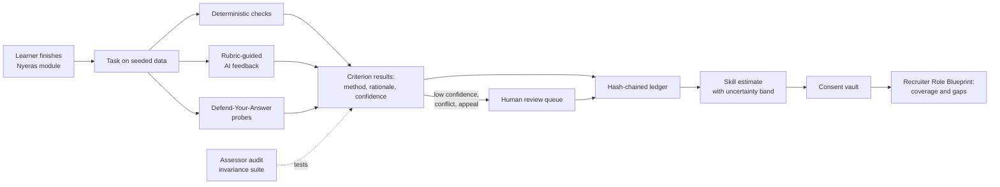

<!-- STATUS: DRAFT -->
# Curated Solution Approach: Crucible (working name)

Owner: product-owner | Gate: G0 (feeds G1/G2) | Version: 0.1 | Date: 2026-10-10 | Reviewer: compliance-auditor
Inputs: delivery/G0-intake/problem-statement-SAMARTHA-02.txt (Part A); delivery/G0-intake/project-brief.md; delivery/G0-intake/part-a-detailed-breakdown.md; research notes in this session (sources in section 14)

> Status: proposal for Founder approval. "Crucible" is our working name, not an official name. Origin tags: **PS §n** = issued problem statement section; **R** = published research; **I** = our inference. Thresholds marked *Proposed* are ours, not from the source.

## 1. Thesis

Existing systems answer "did the learner finish?" and "what did a grader score?". They do not answer "how do we know, and how sure are we?". Crucible makes every claim about a learner carry its own proof:

1. **Verified understanding, not just output.** Each submission is followed by short probes on the learner's own solution, so a correct answer and a confirmed understanding are recorded separately.
2. **A self-auditing assessor.** The grading pipeline is continuously attacked by automatic invariance and directional tests, and its health is published per rubric version.
3. **An honest skill estimate.** Each competency shows an estimate with an uncertainty band that narrows with evidence and widens with time.

It makes no claim that its scores predict hiring outcomes (PS §4, §9).

## 2. The system today: where trust breaks

```
Course -> Quiz / certificate -> CV + keywords -> Recruiter screen -> Interview
          (completion)          (self-claimed)    (opaque signal)
```
Each hand-off drops information. The learner cannot prove ability, and the recruiter cannot inspect it. Adding an AI grader at the second step adds speed but also new failure modes (PS §3).

## 3. Flaw register

Severity is our judgement (H/M/L).

| ID | Flaw / drawback | Hurts | Origin | Sev |
|---|---|---|---|---|
| **Evidence validity** | | | | |
| F01 | Completion and certificates do not show applied ability | Learner, recruiter | PS §1 | H |
| F02 | Quizzes test predefined answers, not reasoning or workplace problem-solving | Learner, recruiter | PS §3 | H |
| F03 | One familiar task is thin evidence; a pass may reflect memorisation | Recruiter | I | M |
| **Grading** | | | | |
| F04 | LLM assessment is inconsistent across repeated or paraphrased input | Learner | PS §3, R | H |
| F05 | AI graders can be manipulated by text inside the submission | Everyone | PS §3 | H |
| F06 | Language, style and verbosity bias | Learner | PS §3, R | H |
| F07 | A single opaque score with no criterion-level rationale | Learner, recruiter | PS §2, §6 | H |
| F08 | Scores shown with false precision and no uncertainty | Recruiter | PS §6, I | M |
| **Integrity** | | | | |
| F09 | Answer-key and hidden-test leakage | Assessor | PS §9 | H |
| F10 | Copying between learners | Assessor | PS §9, R | M |
| F11 | AI-assisted work is neither assumed misconduct (PS) nor easily judged | Learner | PS §9 | H |
| F12 | Hard-coded outputs pass visible tests | Assessor | R | M |
| **Learner agency** | | | | |
| F13 | No route to challenge an assessment | Learner | PS §5 | H |
| F14 | Feedback not actionable; no structured retry | Learner | PS §5 | M |
| F15 | Skills shown as permanent; evidence goes stale | Recruiter | PS §6 | M |
| **Recruiter side** | | | | |
| F16 | CV keyword screening is a weak signal | Recruiter | PS §1 | M |
| F17 | A single ranking invites over-reliance; proxies such as typing speed leak in | Learner | PS §9 | H |
| F18 | Recruiter cannot tell how strong a piece of evidence is | Recruiter | I | H |
| F19 | Fit to explicit role requirements is unclear | Recruiter | PS §5 | M |
| **Privacy and trust** | | | | |
| F20 | Private submissions exposed without consent | Learner | PS §9 | H |
| F21 | A decision cannot be reproduced; the audit trail is missing or alterable | Everyone | PS §6 | H |
| **Fairness and access** | | | | |
| F22 | Disparities across language, accessibility and background go unmeasured | Learner | PS §8, §9 | H |
| F23 | Time and speed treated as skill | Learner | PS §9 | M |
| **Validation and claims** | | | | |
| F24 | Scores presented as hiring predictors without validation | Learner, recruiter | PS §4, §9 | H |
| F25 | Rubric, prompt or model updates silently shift scores | Everyone | I, R | M |
| **Operations and adoption** | | | | |
| F26 | Human review does not scale; reviewers are swamped | Assessor | I | M |
| F27 | LMS-to-recruiter integration is brittle and unclear | Platform | PS §4, I | M |
| F28 | Willingness to pay and reliability unvalidated | Business | PS §10 | M |

## 4. Design principles

1. **Evidence, not scores.** Nothing is shown without its provenance.
2. **Deterministic first.** AI judges only what tests cannot.
3. **Understanding over output.** A correct answer and a confirmed understanding are different facts.
4. **Uncertainty is shown.** The system says how sure it is, and that decays with time.
5. **The learner owns the evidence.** Consent, appeal and retry are core, not extras.
6. **The assessor is audited.** The grading pipeline is tested continuously, in public.
7. **No proxies.** Speed and style are not skill.

## 5. Curated mechanisms

Four layers: **Capture** the work, **Verify** it, **Represent** it, **Trust** it.

| ID | Mechanism | What it does | Basis | Not routine because |
|---|---|---|---|---|
| **M1** | Evidence-structured model | Competency, rubric (evidence rules), and task family defined as linked, versioned objects | [Evidence-Centered Design](https://myweb.fsu.edu/vshute/pdf/essencepreprint.pdf) | Scores are conclusions of an explicit argument |
| **M2** | Layered, labelled evaluation | Deterministic checks first; AI feedback only for judgement criteria; each criterion records method, rationale and confidence; low confidence routes to a human | [Rubric-conditioned grading](https://arxiv.org/abs/2601.08843) | A reader can tell what was tested and what was judged |
| **M3** | Defend-Your-Answer probes | After submission: predict the output of your own query on altered data (executable), and explain a step in plain words (rubric) | [Reading/tracing research](https://www.cs.auckland.ac.nz/~j-hamer/ITiCSE04-wg.pdf), [conversational exams](https://arxiv.org/abs/2601.10691v1) | Verifies understanding without detecting or accusing AI use |
| **M4** | Audit tasks | Find seeded flaws in an analysis, or in a planted wrong suggestion from an allowed AI assistant | [Cognitive forcing](https://www.eecs.harvard.edu/~kgajos/papers/2021/bucinca2021trust.shtml), [review studies](https://2021.icse-conferences.org/details/icse-2021-Software-Engineering-and-Education-Track/27/Assessing-the-Students-Understanding-and-their-Mistakes-in-Code-Review-Checklists-A) | Tests critical use of AI, an actual workplace skill |
| **M5** | Per-learner seeded data | Same task, different seeded dataset per learner; hidden checks; answer fingerprints flag copied values | [Randomised problem pools](https://lagrange.mechse.illinois.edu/pubs/ChWeZi2018a/), [wrong-answer matching](https://www.nber.org/papers/21628) | Integrity without an AI-detector |
| **M6** | Skill estimate with uncertainty band | Per competency: estimate and band; narrows with evidence; widens with time since last evidence | [Glicko](https://en.wikipedia.org/wiki/Glicko_rating_system), [Math Garden](https://dare.uva.nl/id/67ab8977-5e36-4f9f-962d-be294f2b8c09) | One mechanism yields proficiency, confidence and recency |
| **M7** | Assessor audit | Automatic invariance tests (paraphrase, filler, typos, language style, injected instructions) and directional tests (requirement removed lowers score); published per rubric version | [CheckList](https://arxiv.org/pdf/2005.04118), [LLM judge biases](https://arxiv.org/pdf/2306.05685) | The grader is evidence-tested, not trusted |
| **M8** | Tamper-evident ledger | Hash-chained event log of assessment version, rubric, inputs and feedback | [RFC 6962 principle](https://www.rfc-editor.org/rfc/rfc6962) | Any decision can be reproduced and checked |
| **M9** | Consent vault and Role Blueprint | Learner grants scoped, revocable access; recruiter defines role requirements and sees evidence coverage and gaps, never a rank | [ESCO](https://msi.dublincore.org/standards/esco), [Open Badges 3.0](https://www.pok.tech/blog/posts/open-badge-3-0-complete-guide-digital-credentials) | Shows what is missing instead of ranking |
| **M10** | Appeals and uncertainty-first review | Appeals and low-confidence results enter a queue ordered by uncertainty | [Confidence deferral](https://arxiv.org/abs/2601.08843) | Human effort goes where it changes the outcome |

## 6. Flaw-to-mechanism coverage

| Flaw | Mechanisms | How the flaw is closed |
|---|---|---|
| F01, F02 | M1, M3, M4 | Realistic tasks plus verified understanding |
| F03 | M4, M6 | A second, different task type is needed to narrow the band |
| F04 | M2, M7 | Deterministic-first; variance sampled; invariance tests on every change |
| F05 | M2, M7 | Submission handled as untrusted data; injection is a standing test class |
| F06 | M7 | Style, language and filler perturbations must not move scores |
| F07 | M2, M6 | Per-criterion rationale; band instead of a bare number |
| F08 | M6 | Uncertainty is part of the estimate |
| F09, F12 | M5 | Server-side keys; seeded data; hidden checks |
| F10 | M5 | Cross-seed answer fingerprints raise a review flag |
| F11 | M3, M4 | Understanding probed; AI use is a declared, measured skill |
| F13, F26 | M10 | Appeal path; review queue ordered by uncertainty |
| F14 | M2, M5 | Criterion-level, row-level feedback; a fresh seed for each retry |
| F15 | M6 | Evidence age widens the band |
| F16, F19 | M9 | Role requirements as structured data; coverage and gaps shown |
| F17, F23 | M6, M9 | No aggregate rank; no time-based scoring; banned-feature list |
| F18 | M2, M3, M6 | Each item labelled by method; understanding confirmed or not |
| F20 | M9 | Scoped, revocable grants; no grant, no data |
| F21, F25 | M7, M8 | Version-pinned, hash-chained events; regression suite on change |
| F22 | M7 | Perturbation categories include language style and accessibility-related variants |
| F24 | All | Experimental label; validation plan; claim guard |
| F27 | Module `api/` boundaries | Simulated Nyeras and NxtMove adapters behind stable interfaces |
| F28 | Adoption path (section 12) | Validate before any pricing claim |

## 7. How it works end to end



### Roles and what each sees

| Role | Sees | Never sees or does |
|---|---|---|
| Learner | Criterion feedback, probe results, own band and history, who can see what | Another learner's data; an unexplained score |
| Recruiter | Granted evidence, evidence method labels, coverage and gaps against a role | Ungranted submissions; a rank or hire recommendation |
| Reviewer | Original work, AI rationale, rubric, probe results | Learner identity beyond what review needs |
| Auditor | Ledger, assessor health reports | Raw private submissions |

## 8. Demonstration scenario (proposed)

Role: junior data analyst. Competencies: data analysis; written communication of findings. Sandbox: analytics task on a small, per-learner seeded dataset.

1. Learner receives the task on their seeded dataset and submits a query and a short note.
2. Deterministic checks run against hidden cases; AI feedback covers the written note and is labelled.
3. Probe: "On this altered table, what does your query return?" is run and checked.
4. Profile shows the estimate band, evidence labels, understanding confirmed or unconfirmed, and date.
5. Failure case (scripted): an answer that is correct but fails the probe appears as *output verified, understanding unconfirmed*, not as a violation.
6. Second failure case: an embedded instruction in the written note does not move the score, and the event is logged.
7. Learner appeals a criterion; the reviewer outcome is appended to the ledger.
8. Learner grants access; the recruiter sees coverage against the role, with gaps shown.
9. Assessor health report for the current rubric version closes the demo.

## 9. Modules (modular monolith, `api/` surfaces only)

`competency` | `tasks` (task families, seeding, checks) | `assessment` (evaluation, probes) | `integrity` (fingerprints, flags) | `evidence` (events, ledger, estimates) | `consent` | `recruiting` (role blueprints, coverage) | `review` (appeals, queue) | `assessor-audit` (invariance suite, reports) | `identity` (pseudonymous IDs, roles).

Key invariant: every criterion result references one task version, one rubric version, one seed, one submission pointer, one method and one date.

## 10. Responsible design (PS §9 as checks)

| Constraint | Check |
|---|---|
| No equating an experimental score with verified competence | "Experimental" label and band on every estimate |
| Disclose AI use; human appeal | AI-feedback label; appeal on every criterion |
| Minimise data; consent before sharing | Pseudonymous IDs; recruiter query without a grant returns nothing |
| No key leakage; no assumed misconduct | Keys server-side; integrity signals are review flags only |
| No proxy ranking | Banned-feature list; no time-based scoring |
| Probe fairness (our addition) | No time limit; an alternative format on request; a failed probe never penalises the output score |

## 11. Validation plan

| ID | Hypothesis | Method | Metric | Pass line (*Proposed*) |
|---|---|---|---|---|
| V1 | Automated criteria agree with human grading | 10-20 hand-graded synthetic submissions | Agreement per criterion | Report; flag criteria below 80% |
| V2 | Scores are invariant to irrelevant changes | Paraphrase, typos, filler, language-style variants | Share of cases within tolerance | Report failures by category |
| V3 | Scores respond to real errors | Remove a requirement or insert a wrong figure | Share where score drops | Report |
| V4 | Probes separate own-work from copied-work | Team members solve vs receive a solution | Probe pass rate by condition | Report; small N, no generalisation |
| V5 | Seed fingerprints flag cross-seed copying | Inject cross-seed copies and clean controls | Detection and false-flag rate | Report both |
| V6 | The band narrows with evidence and widens with time | Simulated evidence streams | Band behaviour vs design | Matches design |
| V7 | Learners complete, retry and understand the profile | 3-5 supervised testers | Completion, retry, comprehension | Report |
| V8 | Recruiter view surfaces role-relevant evidence | Synthetic pool with known fit | Precision at top-k | Report |

Results are reported as obtained, including failures. No fairness or validity claim is made beyond what these tests show.

## 12. Adoption path

Candidate routes (PS §10): employer subscriptions, paid challenge hosting, enterprise upskilling analytics. Hypothesis to test, not a finding: the assessor health report is a trust artefact buyers may value. No placement-fee proposal until reliability and willingness to pay are validated.

## 13. Scope and 24-hour plan

| Tier | Content |
|---|---|
| **Must** | M1, M2 (deterministic plus labelled AI feedback), M3 predict-output probe, M5 seeded data, M6 band, M7 mini invariance suite, M8 hash chain, two scripted failure cases, validation plan |
| **Should** | M10 appeals and queue, M9 consent and recruiter coverage view |
| **Could** | M4 audit tasks and co-pilot variant, plain-English probe, ESCO mapping for one role |
| **Won't (stated as roadmap)** | Jury grading, full ESCO extraction, signed credential export, real Nyeras/NxtMove integration, validity claims, placement fees |

| Phase | Hours | What this approach delivers |
|---|---|---|
| Round 1 | 0-2 | Interpretation, flaw register, mechanism map, MVP scope (this document) |
| Round 2 | 4-6 | Module map, data model, stack decision, slice plan, risks |
| Mentor | 8-10 | Honest status against the Must tier |
| Round 3 | 12-16 | One end-to-end path: seeded task, checks, probe, band, ledger |
| Round 4 | 22-24 | Full demo, failure cases, assessor health report, validation results |

Cut order if time runs short: signed export, ESCO mapping, audit tasks, plain-English probe, appeals UI, consent UI. The seeded task, deterministic checks, probe, band, ledger and one failure case are never cut.

## 14. Risks and limits

| Risk | Mitigation |
|---|---|
| Too many mechanisms for 24 hours | Must tier fixed; cut order above |
| Probes disadvantage some learners | No time limit; alternative format; no penalty on output score |
| Probe results read as proof of authorship | Labelled "understanding unconfirmed", never "misconduct" |
| Band tuning is arbitrary with little data | Parameters stated; shown as illustrative |
| Invariance suite gives false comfort | Reports the categories tested and no more |
| Seeds change task difficulty | Seeds vary data, not structure; difficulty spread reported |
| Research evidence is thin or transferred | Each claim marked as hypothesis; sources listed |

**Known gaps in the evidence:** no study found that validates probes or seeded-defect scores as hiring signals; the invariance approach is transferred from NLP model testing; several sources were summaries, so figures should be verified against originals before citation.

## 15. Open decisions

1. Approve Crucible as the curated approach, or choose a different headline.
2. Approve the demo configuration (role, competencies, sandbox).
3. Team size and skills, deadline and demo length (drives cut order).
4. Nyeras/NxtMove: provided data or simulated.
5. AI provider and cost limit for rubric-guided feedback.

## Sources

- Evidence-Centered Design: https://myweb.fsu.edu/vshute/pdf/essencepreprint.pdf
- Rubric-conditioned LLM grading: https://arxiv.org/abs/2601.08843
- Reading and tracing skills: https://www.cs.auckland.ac.nz/~j-hamer/ITiCSE04-wg.pdf
- Conversational exam: https://arxiv.org/abs/2601.10691v1
- Cognitive forcing functions: https://www.eecs.harvard.edu/~kgajos/papers/2021/bucinca2021trust.shtml
- Code review study: https://2021.icse-conferences.org/details/icse-2021-Software-Engineering-and-Education-Track/27/Assessing-the-Students-Understanding-and-their-Mistakes-in-Code-Review-Checklists-A
- Randomised problem pools: https://lagrange.mechse.illinois.edu/pubs/ChWeZi2018a/
- Wrong-answer matching: https://www.nber.org/papers/21628
- Glicko: https://en.wikipedia.org/wiki/Glicko_rating_system
- Math Garden: https://dare.uva.nl/id/67ab8977-5e36-4f9f-962d-be294f2b8c09
- CheckList: https://arxiv.org/pdf/2005.04118
- LLM judge biases: https://arxiv.org/pdf/2306.05685
- RFC 6962: https://www.rfc-editor.org/rfc/rfc6962
- ESCO: https://msi.dublincore.org/standards/esco
- Open Badges 3.0: https://www.pok.tech/blog/posts/open-badge-3-0-complete-guide-digital-credentials
