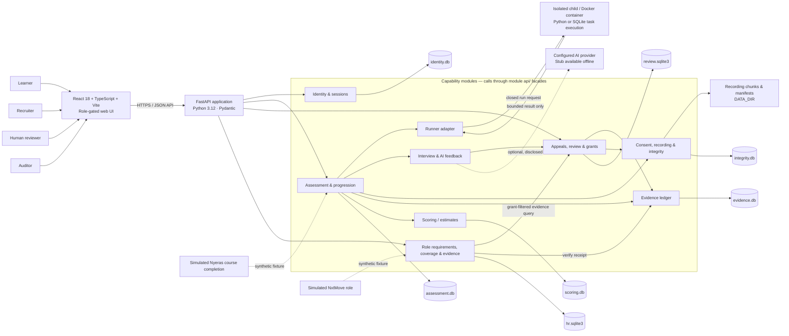
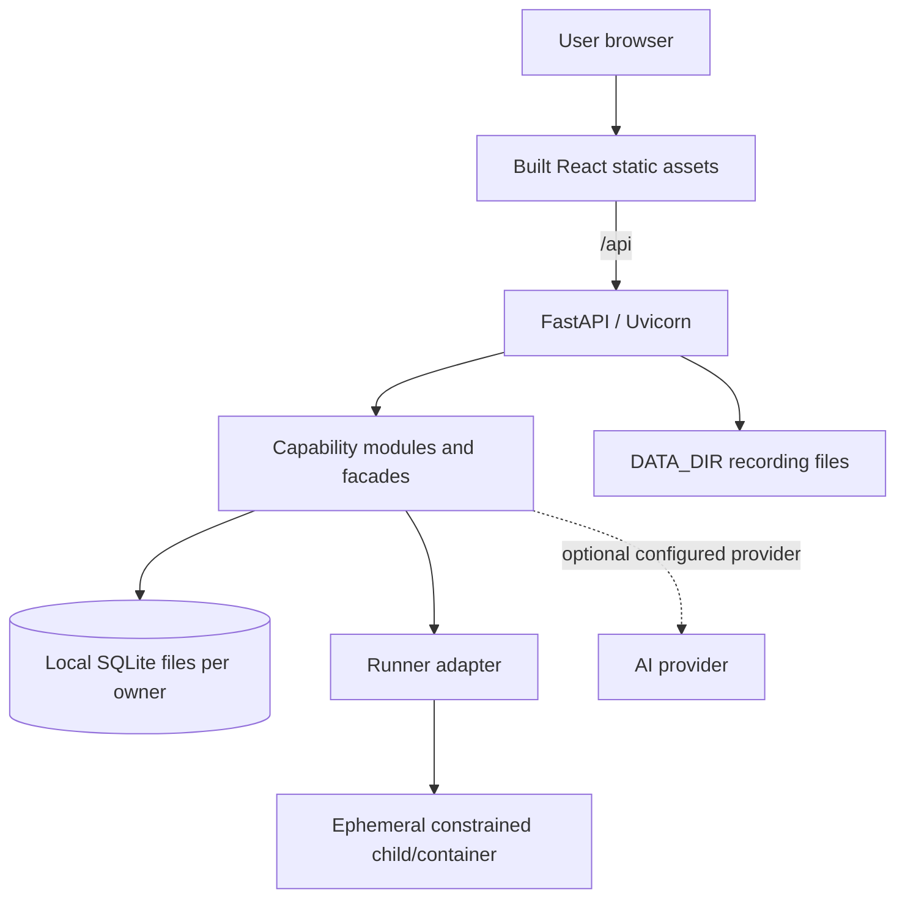

<!-- STATUS: DRAFT -->
# Crucible — High-Level System Design

> **Purpose:** explain the system to product, design, engineering and hackathon reviewers in one place. This document describes the current repository implementation and separates it from architecture choices that are still proposed. Crucible is a working name. Nyeras and NxtMove are simulated; demo data are synthetic.

## 1. Product in one sentence

Crucible gives learners a private, step-by-step place to demonstrate job-relevant skills, explains how each result was reached, routes uncertainty to human review, and lets the learner decide whether to share evidence with a recruiter.

It is a proof-of-skill workflow—not a complete learning management system, a hiring predictor, or an automated hiring decision tool.

## 2. People and outcomes

| Person | What they do | What the system protects |
|---|---|---|
| Learner (Nyeras) | Completes skill levels, sees feedback, retries, appeals, reviews their evidence profile, and grants or revokes sharing | Private work stays private; each result is explainable; no speed score or automatic misconduct verdict |
| Recruiter (NxtMove) | Defines a role and inspects evidence that a learner has chosen to share | No access without a live grant; no candidate ranking, aggregate score, or hire/reject recommendation |
| Human reviewer | Resolves appeals, uncertain assessments, method disagreements, and integrity flags | Original work and rubric context are visible; decisions and reasons are recorded |
| Auditor | Checks evidence ledger integrity and assessment health | Verification result is explicit; records retain links to the task, rubric, method and date |

## 3. Architecture at a glance

The running product is a **single FastAPI application** with capability modules behind explicit `api/` facades. The modules own separate SQLite files. The learner, reviewer, recruiter and auditor screens are role-gated views in the React web application. The isolated code runner is a separate child/container execution boundary, called through the runner module.

**Reading the diagram:** the browser is the presentation layer; FastAPI routes requests to the capability that owns the action; each module owns its data; only the runner executes learner code. Recruiter evidence is returned through a grant check, not by opening the learner's assessment records directly.

## 4. Technology stack

### Implemented in the current repository

| Layer | Technology | Current use |
|---|---|---|
| Web client | React 18, TypeScript 5, Vite 8, React Router | Role-aware screens for learner, recruiter, reviewer and auditor; CodeMirror editor support for Python and SQL; Vite proxies `/api` during local development |
| HTTP/API | FastAPI, Uvicorn, Pydantic 2 | One HTTP composition root; routers are mounted from capability modules; authenticated role comes from server-side session state |
| Backend language | Python (project targets Python 3.12) | Assessment, identity, scoring, evidence, interview, HR, review, integrity and runner modules |
| Persistence | Python standard-library `sqlite3`, one file per current module/context | Explicit data ownership without a database server; some initial ADRs proposed SQLAlchemy/Alembic, but implemented modules use direct `sqlite3` behind module stores |
| Learner code isolation | Narrow runner module; child harness; Docker-per-run with fixed configuration, plus an explicitly labelled process fallback when enabled | Runs validated task submissions under resource caps; the HTTP API does not accept arbitrary container options or paths |
| Contracts | JSON Schema 2020-12 and Pydantic edge models | Validates evidence, grant, role and shared-evidence payloads; schema files are the shared language at system boundaries |
| Evidence integrity | Python `hashlib` / SHA-256, canonical JSON, append-only hash chain | Evidence entries link to the preceding entry; verification reports the first mismatch |
| AI integration | `FeedbackProvider` interface, deterministic stub, configurable Anthropic adapter | AI feedback is optional, structured, disclosed, and can fall back to a deterministic stub; secrets are configuration/environment-only |
| Tests and quality | pytest, Vitest, Testing Library, axe-core | Unit, integration, architecture-boundary, contract and UI accessibility checks exist; live browser coverage remains a documented gap |

### Proposed / not a final architecture decision

- **ADR-0001 is Proposed:** it recommends FastAPI + Pydantic, SQLAlchemy 2 + Alembic, SQLite per bounded context, stdlib SQLite for SQL task execution, and React + TypeScript + Vite. The actual module stores currently use `sqlite3` directly, so do not describe SQLAlchemy/Alembic as already in use.
- **ADR-0002 is Proposed:** the recommended topology is a modular monolith with `sandbox`, `trust`, and `hr_portal` context groups. The current app is a single FastAPI process, and individual modules call through facades/ports. Separate processes may be introduced if measured isolation or availability needs justify them.
- PostgreSQL is a possible later move for concurrent writers or hosted use; it is not the current demo database.
- Production hosting, managed identity, distributed queues, and high-availability operation are not part of the current demo design.

## 5. Main components and responsibility boundaries

| Component | Owns | Key interactions |
|---|---|---|
| Web application | Navigation and role-specific views; forms, task editor, session UI, evidence display | Calls the `/api` surface; must not infer authorization from a hidden UI element |
| Identity | Password verification, server-side sessions, roles, learner pseudonyms and recruiter aliases | Authenticates every protected route; role assignment is server-side |
| Assessment and progression | Task bank, attempts, level state, answers, retry variants, pass rules | Uses runner for checks; emits evidence; opens the live Level 4 interview after prerequisites |
| Runner | Validated execution request, limits, isolated child/container process and bounded result | Only module that invokes execution infrastructure; no expected answers are passed into learner code |
| Intelligence / interview | Optional AI feedback and Level 4 interview state | Uses a provider port; records model reference and disclosure; can route uncertainty to review |
| Integrity | Consent binding, pre-check, event ingestion, recording chunks, manifests, reviewer summary and similarity flags | Learner consent is required before capture; summary/flags are advisory and reviewer-only |
| Evidence ledger | Append-only events, idempotency and hash-chain verification | Records assessment, review and recording-manifest evidence; stores hashes and event metadata rather than raw task answers |
| Scoring / profile | Gated per-competency estimate and uncertainty range | Updates only under the configured pass gate and ledger checks; presentation remains experimental and evidence-linked |
| Review and consent | Appeals, review queue, reviewer decisions, share grants, revocation and shared-evidence query | Writes human decisions to evidence; enforces grant scope and expiry on every recruiter query |
| HR portal | Versioned role requirements, coverage states, gaps and evidence viewer | Queries Trust/review facade for grant-filtered evidence; never calls learner assessment directly |

**Boundary rule:** modules interact through their public `api/` surfaces or injected ports. The HR module must not import or call the assessment/Sandbox module. Only the evidence module writes the evidence ledger.

## 6. Key end-to-end flows

### 6.1 Learner demonstrates a skill

1. Learner signs in; the server resolves the user's role and learner alias.
2. Learner opens **My path**, selects the next unlocked level, and reads its instructions and criteria.
3. Learner works on their assigned task/data and submits an answer.
4. Assessment calls the runner using a closed request shape. The runner launches the child/container with fixed limits; hidden checks stay in the trusted parent and are not sent to the learner process.
5. Assessment returns criterion-level findings, method labels and explanations. Optional AI feedback is explicitly labelled and never silently replaces deterministic checks.
6. Learner completes the changed-data understanding probe where configured. Output correctness and understanding are reported separately.
7. Failed levels can be retried on a fresh variant; passed levels remain recorded. Progress and evidence events are stored.
8. Level 4 begins only when prerequisites are satisfied. The learner reviews consent and recording scopes before camera, microphone, screen or integrity-event capture begins. Text/captions remain available as an accessible alternative.
9. Interview results are evaluated against criteria. Low confidence, disagreement, an appeal, or an integrity flag can create a human review case. An integrity flag never auto-fails a learner.
10. Profile shows available evidence, methods, dates and an experimental estimate range when the gate allows it.

### 6.2 Learner shares and recruiter reviews

1. Learner opens **Sharing**, selects an organisation/role and scope, previews the exact information, selects an expiry, and confirms.
2. Learner can revoke the grant. Revocation is checked on the next recruiter evidence query.
3. Recruiter defines a versioned role with explicit competencies and evidence conditions.
4. HR asks the Trust/review facade for evidence scoped to the authenticated recipient and role. No active grant returns no evidence, indistinguishable from an absent candidate.
5. Recruiter sees per-competency coverage and gaps, then opens individual evidence to inspect the method, date, rubric version and receipt verification.
6. Recruiter makes their own human judgement. The product does not rank people or recommend hire/reject decisions.

### 6.3 Appeal and human review

1. Learner appeals a result or the system routes an uncertain/disputed case to the reviewer queue.
2. Reviewer sees the original work, criteria/rubric version, relevant probe/interview context, AI rationale and any reviewer-only integrity summary.
3. Reviewer upholds, changes, or requests more information and must give a reason.
4. Decision is appended to the evidence ledger and becomes visible in the learner's appeal status. Retry of a failed recording action must not create duplicate decisions.

### 6.4 Audit

An auditor verifies the hash chain and reviews assessor-health information for a rubric version. A match means the stored record is internally consistent; it does not prove that the assessment predicts job performance or that the underlying judgment is fair.

## 7. Data ownership and movement

| Data | Owner/store | Movement and privacy rule |
|---|---|---|
| Account and session | Identity module / `identity.db` | Password hashes and session-token hashes are stored; raw session token is held by an HttpOnly cookie |
| Attempts and learner answers | Assessment module / `assessment.db` | Learner-specific; not returned to recruiters as a default |
| Runner task specs | Runner module / its task store | Closed schema, allow-listed task/dataset identifiers and size limits; expected outputs remain outside learner execution |
| Evidence events and chain | Evidence module / `evidence.db` | Append-only; canonical payload hashes link entries; idempotency prevents duplicate append on retry |
| Profile estimate | Scoring module / scoring store | Derived from eligible evidence; rebuildable; always shown with uncertainty, date and experimental label |
| Share grants and review items | Review module / `review.sqlite3` | Expiring grants and explicit scope; checked at query time; revocation takes effect on next query |
| Role and role versions | HR module / `hr.sqlite3` | Belongs to the authenticated recruiter organisation; edits create versions |
| Integrity events and recordings | Integrity module / `integrity.db` plus `DATA_DIR/recordings/` | Capture begins only after consent; chunks are hashed; retention purge must be scheduled by the entrypoint |
| AI request/response | Intelligence adapter and assessment flow | Delimited as untrusted learner content; structured result only; disclose AI use; do not send identifiers unnecessarily |

**Important design boundary:** the learner's raw code/answers stay within the assessment context. Evidence carries a reference/hash and assessment facts, not an unrestricted copy for recruiters. Explicitly shared submission content is off by default and is not populated in the current build.

## 8. Security, privacy and responsible-use controls

- **Authentication:** server-side roles and sessions; frontend route guards are usability only, not authorization.
- **Authorization:** each API route checks role and ownership; unknown and foreign attempt identifiers should return the same not-found response.
- **Execution isolation:** closed runner schema, server-built container arguments, no learner-controlled paths/options, no network, read-only filesystem, no mounts, unprivileged user, CPU/memory/process/output/time bounds; fail closed unless a clearly labelled fallback is explicitly enabled.
- **Hidden checks:** run outside the untrusted learner process; never expose expected values through task API or runner input.
- **Evidence tampering:** append-only interface, canonical hashing, chain verification and idempotency keys.
- **Consent:** bind consent to the attempt and exact capture scopes; refuse storage/playback for scopes not granted; disclose recording and AI use before the Level 4 session.
- **Integrity signals:** advisory, neutral language, visible only to reviewers, and never automatic penalties or score changes.
- **Sharing:** no recruiter evidence without a current grant; scope, recipient, role and expiry are checked on each request; no personal email/name in recruiter evidence.
- **AI:** provider behind an interface, deterministic offline stub, schema-checked responses, no secrets in source, clear disclosure and human appeal path.
- **Responsible display:** no speed scoring, opaque aggregate rank, validated-hiring claim, or automated hire/reject recommendation.

## 9. Quality attributes and operating assumptions

| Attribute | Design response | Current limit / evidence gap |
|---|---|---|
| Safety of learner execution | Isolated runner and abuse/escape tests | Process fallback has different guarantees; must be labelled; production threat review remains necessary |
| Integrity and auditability | Hash-chained ledger, recording manifest hashes, provenance fields | Current local ledger does not detect removal of the newest suffix without a signed external chain head |
| Privacy | Separate module stores, pseudonyms/aliases, share grants and consent scopes | Local demo is not a production privacy deployment; encryption at rest and rate limiting are open gaps |
| Reliability | Stub AI path, idempotent evidence append, retryable upload queue | Single-host/local data directory; no HA or distributed queue |
| Accessibility | Keyboard support, captions/text alternative, semantic UI and axe checks | Real-browser, small-screen reflow and physical media-device checks are not complete |
| Modifiability | Module facades, ports, contract schemas, architecture tests | ADR-0001/0002 remain proposed and independent review/approval is pending |
| Performance | Bounded results and demo-scale workloads | No production load target or benchmark claim |

## 10. Deployment view

**Current demo shape:** one local FastAPI process plus the React/Vite frontend, SQLite files and a local recording directory. The runner uses Docker when available; the process fallback is explicitly identified in results and must not be described as container isolation. An optional AI provider can be configured; the deterministic stub allows offline flow.

**Recommended direction (ADR-0002 Option B, still Proposed):** keep a modular monolith with Sandbox, Trust and HR Portal as bounded-context groups in one deployable unit. Preserve separate module databases and public facades. Split a context into a separate process only when an actual isolation, scaling or availability requirement justifies the operational cost.

## 11. Decisions and open items

1. ADR-0001 (technology stack) is **Proposed**. Actual implementation details in this document are based on source and build logs, not inferred acceptance of the ADR.
2. ADR-0002 (three contexts and deployment topology) is **Proposed**. Modular monolith is the working recommendation; do not claim three independent deployed services.
3. ADR-0003 describes OS-level/container isolation, but the runner build log says it is an in-process module using Docker CLI through a fixed adapter, not a separate HTTP service.
4. Independent security and quality reviews are pending in the build log. Passing implementation tests is not the same as approval for production use.
5. Recording retention purge is implemented as a callable operation but needs reliable entrypoint scheduling.
6. Browser-media capture, fullscreen, camera, microphone and video behavior were tested with fakes; real-browser operation still needs a device/browser verification pass.
7. Real Nyeras/NxtMove APIs are not connected. All displayed sample organizations, tasks and learner evidence must be identified as synthetic/demo content.

## 12. Non-goals and truthful claims

The system does **not** claim that an experimental estimate predicts job performance, proves authorship, detects cheating, or guarantees fairness. A matching ledger hash verifies record consistency only. A reviewer decision is a recorded human judgment, not ground truth. The prototype is a constrained demonstration and needs broader user, security, privacy and fairness validation before consequential employment use.

## 13. Source references

- `delivery/G3-solution-design/architecture-overview.md` — modules, boundaries, contracts and quality attributes.
- `delivery/decisions/adr/ADR-0001-stack.md` — stack proposal and tradeoffs.
- `delivery/decisions/adr/ADR-0002-three-systems.md` — deployment options and modular-monolith recommendation.
- `delivery/decisions/adr/ADR-0003-os-level-sandbox.md` — runner isolation design.
- `delivery/G3-solution-design/ux-flows.md` — learner, recruiter, reviewer and auditor flows.
- `delivery/G5-build-log/build-log.md` and each `product/modules/*/MODULE.md` — implemented behavior, tests and known gaps.
