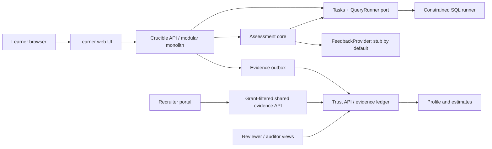
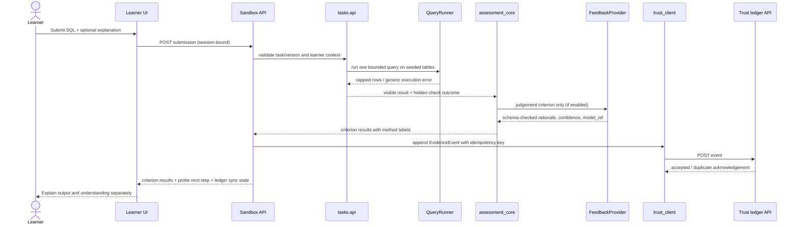

<!-- STATUS: DRAFT — ROUND 2 ARCHITECTURE / TECHNICAL STRATEGY REFERENCE -->
# Crucible Sandbox: Round 2 Architecture and Technical Strategy

Owner: principal-architect | Gate: G3 design reference | Version: 0.1 | Date: 2026-10-10

> **Purpose.** Round 2 is scored on architecture and technical strategy. This document specifies the learner task sandbox and its connections to assessment, evidence, and trust so the team can explain what will run, where untrusted SQL goes, how results are checked, what can be completed in 24 hours, and what the fallbacks are. It is a draft design reference, not approval to start implementation or a claim that the sandbox currently works.

## 1. Round 2 framing

The authoritative event handbook is `reference/24_Hour_Hackathon_Handbook.pdf`. The workspace's handbook-derived scoring guide is `profiles/hackathon-24h/rubric.md`; its Round 2 weights are:

| Round 2 criterion | Weight | What this proposal provides |
|---|---:|---|
| Solution architecture | 5 | Context, component, trust-boundary, and submission-flow diagrams; ownership and contracts |
| Technical feasibility | 4 | Thin 24-hour vertical slice, local-first stack, measurable limits, and honest assumptions |
| Technology selection and justification | 3 | SQL runner, API, storage, UI, and AI adapter choices with tradeoffs |
| Data / AI / algorithmic approach | 3 | Per-learner seeds, deterministic checks, probes, bounded AI judgment, and evidence events |
| Implementation strategy and scope | 3 | Must-have sandbox path, build sequence, cut line, and evidence checkpoints |
| Risk and contingency | 2 | Threats, mitigations, owner, detection, and fallback behavior |

The scoring guide says judges should favor demonstrated evidence over claims: live functionality, tests/benchmarks/user evidence, limited prototypes, architecture artefacts, then slides. This is an architecture submission: clearly identify planned decisions and intended tests as such. Never describe a mockup, fixed response, or simulated service as functional. Keep requirement-to-feature-to-evidence traceability for Rounds 3 and 4.

## 2. Product scope and sandbox objective

Crucible is the workspace's selected SAMARTHA Part A direction: a proof-of-skill sandbox within a simulated Nyeras-to-NxtMove flow. The sandbox lets a learner solve a realistic SQL analytics task on a learner-specific synthetic dataset, receives transparent criterion-level results, and can answer a probe using changed data to demonstrate understanding. Results become evidence that the learner can inspect and selectively share.

**In scope for this sandbox architecture:**

- One draft demo role: Junior Data Analyst.
- Two separate competencies in the product context: Data analysis (SQL) and Communication of findings. This document focuses on the SQL execution sandbox; communication remains a separately assessed competency.
- Versioned task/rubric metadata, per-learner seeded data, a SQL editor, one-statement read-only query execution, hidden deterministic checks, visible feedback, a changed-data understanding probe, saved progress, and evidence-event handoff.
- Synthetic learner/job data and simulated integrations only unless access is supplied.

**Out of scope for this 24-hour slice:**

- Arbitrary Python/code execution, shell access, package installation, network access, or uploaded executable files.
- Production-grade multi-tenant hosting, high availability, autoscaling, a public task marketplace, a complete LMS, or real Nyeras/NxtMove integration.
- Automatic hiring decisions, candidate ranking, employability claims, or an aggregate competency score.
- A production-grade container sandbox unless the chosen execution design and time budget are explicitly changed and evidenced.

## 3. Core user journey

1. Learner enters the clearly labelled demo workspace and opens **My path**.
2. Learner selects the current SQL level and reads the task, dataset schema, visible sample rows, output format, and rubric criteria.
3. Learner edits SQL in the browser editor. The page states **SQLite SQL** and explains that the preview runs against the learner's seeded sample data.
4. Learner may choose **Run preview**. This returns a bounded result table and safe, generic SQL errors. It does not reveal hidden checks or expected hidden outputs.
5. Learner selects **Submit for assessment**. The API validates the request and sends the SQL to the same constrained query runner used by the preview and understanding probe.
6. Assessment core runs deterministic hidden checks outside the learner-visible database and, where needed, separately invokes the labelled AI feedback adapter for judgement criteria only.
7. The learner sees each criterion result with method label, rationale, rubric version, and visible-row differences only where safe.
8. Learner answers a changed-data probe that reruns their own query through the same query-runner API. Output correctness and understanding status are displayed separately.
9. Sandbox creates an evidence event; Trust appends it idempotently to the tamper-evident ledger and updates the per-competency projection. If Trust is unavailable, the outbox retains the event and reports a pending sync state; it must not claim ledger persistence before acknowledgement.
10. Learner can inspect the evidence in their profile. Recruiters can only query fields covered by an active learner grant.

No step has a countdown or speed score. The learner may save and leave. A failed or missed probe is worded **“Output verified, understanding unconfirmed”** when the main output is correct; it never retroactively lowers that output result.

## 4. System context

**System ownership:** Sandbox owns task execution, seed generation, submissions, deterministic evaluation, probes, and progression. Trust is the source of record for accepted evidence events, grants, appeals, assessor reports, and estimate projections. HR Portal owns role requirements and computes per-competency coverage using only grant-filtered shared evidence. The HR Portal never calls the Sandbox directly.

**Round 2 boundary statement:** UI controls are not security controls. The server derives learner identity and role from the authenticated session; it does not trust a learner ID in a request body. Browser code never receives service keys, hidden checks, expected outputs, AI provider keys, or signing keys.

## 5. Component and data-flow design

### 5.1 Learner UI

- Task brief, visible rubric, SQLite SQL editor, schema/data preview, preview results, submission state, criterion feedback, probe, and saved progress.
- Client-side validation improves usability but is repeated server-side.
- Do not bundle hidden tests, answer keys, environment secrets, Trust service keys, or AI credentials into the client.
- Show “Prototype / simulated” labels for any nonfunctional integration or canned response.

### 5.2 Sandbox API and module boundaries

Use the existing proposed modular-monolith boundary and keep cross-module calls on each module's `api/` facade:

| Module | Owns | Sandbox interaction |
|---|---|---|
| `competency` | Competencies, rubric criteria and immutable versions | Publishes task/rubric IDs and visible criteria |
| `tasks` | Task definitions, per-learner seed, learner dataset, submission, `QueryRunner` port, hidden checks | Provides task and executes preview/probe queries |
| `assessment_core` | Deterministic results, criterion rationale and method labels | Calls task API for checks; calls AI adapter only for judgement criteria |
| `probes` | Altered data and prediction answers | Calls the same `tasks.api.run_query` surface |
| `ai_adapter` | FeedbackProvider port, stub and optional provider adapter | Receives minimum necessary text/rubric; returns schema-validated, labelled output |
| `progression` | L1-L4 state and attempt history | Saves current level and gates transitions |
| `trust_client` | Evidence event construction and idempotent outbox | Delivers event to Trust and retries safely |

No unrelated module imports a SQL driver. Only `tasks` infrastructure implements the `QueryRunner` port. This makes it possible to replace the execution backend without spreading engine-specific logic.

### 5.3 Submission sequence

### 5.4 Sandbox execution boundary

Learner SQL is hostile input. Run it only against a fresh, per-attempt in-memory SQLite database populated with that learner's synthetic tables. The learner's database must never contain hidden test tables, expected result values, another learner's rows, local files, or application database handles.

Minimum controls in the current draft threat model:

1. Accept exactly one statement. Reject multiple statements and any syntax outside the supported SELECT subset.
2. Enable SQLite query-only mode and install an authorizer allow-list for `SELECT`, `READ`, and explicitly allowed functions. Deny writes, schema changes, `ATTACH`, `PRAGMA`, extension loading, file access, and unapproved functions.
3. Keep hidden checks and expected outputs in assessment-owned storage, not in the query database or learner API response.
4. Use SQLite's progress handler/instruction budget plus a hard wall-clock cutoff; cap query text, returned rows, and serialized response size. Proposed indicative caps in source design: 10 KB SQL, 1,000 rows, 1 MB result, about 2 seconds per execution. Treat these as proposed demo limits to tune and measure, not handbook requirements.
5. Return generic error copy to the learner. Log a bounded, redacted diagnostic reference server-side; never include hidden values or filesystem details in the error.
6. Reuse the exact same `QueryRunner` API for preview, deterministic assessment, altered-data probes, and Level 4 adaptations. Do not create a less restricted secondary execution path.
7. Run the runner in a separate bounded worker process if feasible. Terminate the worker on wall-time breach and cap its memory and concurrency. The process receives only the seed data and query request, not application secrets.

**Important architecture decision to close before implementation:** the draft threat model calls for a separate worker process with memory/time limits; ADR-0001 currently selects standard-library `sqlite3` but notes that the engine runs in the API process and consumes CPU until its step budget trips. The architecture diagram JSON also describes an ephemeral container. These are different isolation strengths and cannot be presented as the same thing. For the 24-hour MVP, the recommended Round 2 decision is: **no arbitrary general-purpose code; constrained SQLite in a separate worker process if verified quickly; if that cannot be delivered safely, replace free-form SQL with a fixed query-choice/template task.** Do not claim container-level isolation unless a container is actually implemented and tested. Record the final choice and residual risk in the ADR/threat model before build.

## 6. Data and assessment strategy

### 6.1 Seeded task data

- Each learner receives a deterministic, pseudonymous seed so the task structure is consistent while row values differ.
- The same learner/task/version seed reproduces the same dataset for support and audit; a retry uses a fresh seed when retry support is in scope.
- Dataset generation uses synthetic records and contains no real personal data.
- Seed derivation secrets stay server-side. Do not expose the secret or use seed IDs that reveal identity.
- State the limitation: different data reduces copying of answer values but does not prevent copying a correct seed-independent SQL query. Understanding probes and reviewer-only similarity flags address different risks; neither proves authorship.

### 6.2 Evaluation ordering

1. Validate session, task ID/version, request size, SQL statement count, and allowed syntax.
2. Run visible preview safely; do not reveal hidden check details.
3. Run deterministic hidden checks in assessment-owned logic and emit only criterion-level outcomes and safe feedback.
4. Call AI only for rubric criteria that require judgment (e.g. written interpretation), with a fixed system instruction, submission text treated as untrusted data, minimal payload, schema validation, confidence, and `model_ref`.
5. If model output is invalid, unavailable, over budget, or low confidence, label the fallback and route for human review as appropriate. A stub is not a real AI result.
6. Run an understanding probe on altered input using the learner's own query and the same constrained runner.
7. Write a method-labelled EvidenceEvent with task/rubric versions, seed reference, submission hash/reference, date, and criterion outcomes. Do not put raw submission text or personal data in the ledger event.
8. Update a per-competency projection only under the defined progression rule. Draft product rule: an estimate changes after all four levels of that competency pass; each passed level remains visible evidence before that.

### 6.3 AI boundary

- Stub adapter is default so a clean offline demo works.
- Real provider is behind `FeedbackProvider`; provider credentials are server-side configuration and declared in the dependency register.
- Send only the criterion rubric and minimum learner text needed for that criterion; do not send learner ID, seed ID, name, recruiter role, or hidden checks.
- Treat submission text, comments, and model response as untrusted. Model output must validate against a strict schema. Render rationale as plain text; strip unsafe markup/URLs where applicable.
- AI cannot grade deterministic SQL correctness or override hidden checks. Instruction injection must not change any score; if detected, any flag is reviewer-only and does not lower outcome.
- Label every involved result “AI-assisted judgement” and make appeal available.

## 7. Technology selection and justification

The table reflects current proposed ADR-0001 and workspace architecture; these are proposals pending gate approval.

| Concern | Proposed choice | Why it fits a 24-hour event | Tradeoff / boundary |
|---|---|---|---|
| API | Python 3.12 + FastAPI | Fast to scaffold, Python ecosystem, typed request surfaces | Keep business logic outside route handlers; validation is not authorization |
| Learner/recruiter UI | React + TypeScript + Vite | Fast interactive editor/dashboard, compile-time checks, one frontend skillset | Two role-specific frontends or strict route/role separation; no service secrets in bundle |
| Product persistence | SQLite via SQLAlchemy/Alembic, one file per bounded context | Local-first, no database service setup; workable for single-machine demo | One writer bottleneck and fewer database permissions; append-only behavior needs application rules/triggers |
| Learner SQL engine | Python standard-library `sqlite3`, fresh in-memory DB | No SQL engine download; `set_authorizer`, `query_only`, and progress handler provide useful constraints | SQLite dialect only; in-process CPU risk unless worker isolation is added; not a general code sandbox |
| Evidence integrity | Canonicalized hash-chained append-only ledger in Trust | Local demonstrability and verifiable tamper check | Hash chain is tamper-evident, not a claim against a privileged operator rewriting the entire chain; signing/anchoring is stretch/open item |
| AI feedback | `FeedbackProvider` port, offline stub first, optional single provider adapter | Demo is repeatable without network/provider budget; adapter preserves vendor swap | A stub must be labelled; real provider adds privacy, cost, latency, and reliability risks |
| Local orchestration | Single-machine launch/compose only if it reduces setup risk | One-command demo and repeatable clean start | Don't add container infrastructure unless it improves actual isolation or reproducibility and can be validated in time |

Use existing proposed libraries only after they are entered in `delivery/G4-delivery-plan/dependency-register.md`; disclose APIs, datasets, models, and third-party libraries as required by the hackathon profile. Do not select technology for novelty. Keep the query runner behind a port and use the workspace contract schemas as the shared boundary language.

## 8. Storage and ownership

| Data | Owner | Retention/representation in demo |
|---|---|---|
| Task definition, rubric version, hidden checks | Sandbox `tasks` / `competency` | Versioned synthetic task bank; hidden checks server-side |
| Learner seed tables | Sandbox `tasks` | Recreated in memory for each execution; do not persist a shared writable database |
| Submission SQL and explanation | Sandbox | Private learner work; submission reference/hash in evidence event; access is restricted |
| Criterion outcomes and method metadata | Trust ledger after acknowledgement | Append-only evidence event; idempotency key handles retry |
| Estimate/progress projection | Trust `estimates`/profile | Derived from ledger; rebuildable and never edited as source of truth |
| Share grants | Trust consent module | Scoped to competency/recipient, expiry required, revocation checked on every query |
| Recruiter role requirements | HR Portal | Version on edit; evidence response is grant-filtered and not retained as a candidate cache |
| AI output | Sandbox adapter, then evidence metadata as permitted by contract | Label model/method; avoid retaining extra prompt data; no raw AI transcript in recruiter view |

The exact retention period for raw submissions and access logs is unresolved. The prototype must not invent a retention policy; use synthetic data and flag this for product/security review.

## 9. API/contract sketch

These are operation-level descriptions, not replacement schemas. Contract files under `delivery/G3-solution-design/contracts/` remain authoritative for cross-boundary shapes.

| Operation | Caller → owner | Purpose | Must not return |
|---|---|---|---|
| `GET /tasks/{task_id}` | Learner UI → Sandbox | Task text, visible rubric, learner seed data/schema, task version | Hidden checks, expected hidden output, other learner data, secrets |
| `POST /tasks/{task_id}/preview` | Learner UI → Sandbox | Bounded read-only query preview | Hidden checks, arbitrary database access, unbounded output |
| `POST /submissions` | Learner UI → Sandbox | Submit one query and optional explanation under session identity | Trust key, evaluator internals, hidden expected values |
| `POST /probes/{submission_ref}/answer` | Learner UI → Sandbox | Record prediction/explanation against altered data | Probe answer key before response, other submissions |
| `GET /progress` | Learner UI → Sandbox | Session-bound learner progress | Any caller-supplied learner's progress |
| `POST /events` | Sandbox service → Trust | Append method-labelled evidence idempotently | Trust accepting caller-supplied ledger fields/status or raw private submission |
| `POST /shared-evidence/query` | HR Portal → Trust | Return evidence filtered by recipient and active grant | Ungranted candidate existence, ungranted fields, cross-recipient IDs, aggregate rank |

All payloads are size-limited, schema-validated, reject unknown sensitive fields, and are authorized server-side. The event response distinguishes **accepted**, **duplicate of accepted event**, **pending/retry**, and **rejected**; the UI must reflect actual persistence state.

## 10. Feasibility and 24-hour cut line

### Minimum credible sandbox slice (Must)

1. One synthetic SQL task, one rubric version, and a visible schema/data preview.
2. Learner session bound to a demo learner; no learner ID trust from request payload.
3. One SELECT-only query execution path with exact one-statement validation and bounded runtime/output.
4. At least one deterministic hidden check that does not leak answer keys.
5. Criterion-level result with method label and safe rationale.
6. One altered-data understanding probe through the same runner.
7. One evidence event accepted by Trust, visible in the learner profile; hash verification demonstration.
8. Tests/evidence for write rejection, hidden-check secrecy, time/resource bounds, session isolation, probe score separation, and evidence idempotency.
9. Clean-start local run that works without a network or paid AI service.

### Should, only after Must is demonstrably stable

- Fresh-seed retry and attempt history.
- Reviewer appeal queue and decision event.
- Consent-grant flow and one grant-filtered recruiter evidence view.
- Labelled AI-assisted narrative criterion with injection test and stub fallback.

### Cut first if behind

1. Real external AI provider (keep clearly labelled stub).
2. Level 4 adaptive session (keep a scripted, labelled prompt only if time permits).
3. Multi-competency breadth (keep SQL vertical slice; show communication as separately scoped).
4. Recruiter query breadth, advanced filters, and elaborate charting.
5. Similarity fingerprinting and nonessential profile polish.

Never cut query isolation controls, hidden-check secrecy, output/understanding separation, evidence provenance, or honest disclosure of what is simulated. If free-form SQL isolation cannot be made credible, cut free-form execution and demonstrate fixed, pre-authored query choices instead of pretending the unsafe path is safe.

## 11. Delivery slices and Round 2 exit evidence

| Slice | Goal | Exit evidence to capture |
|---|---|---|
| S0 — decision and contract | Agree runner isolation choice, demo role/task, event schema, auth model | Approved ADR delta, threat-model decision, sample valid contract payload |
| S1 — vertical skeleton | API, UI shell, task fixture, clean start | One command/short steps from clean checkout; health checks; dependency disclosure |
| S2 — safe query | Seeded in-memory DB, read-only authorizer, bounded execution | Automated hostile-query results; execution timing/result caps; no key leak |
| S3 — evaluation | Hidden deterministic check and criterion response | Correct and incorrect sample submissions with method-labelled results |
| S4 — understanding probe | Altered data and output/understanding distinction | Correct-output/wrong-prediction demonstration; unchanged output result |
| S5 — evidence path | Event outbox to Trust, profile projection and ledger verification | Event ID/sequence acknowledgement; replay idempotency; tamper check on synthetic event |
| S6 — demo polish | Error, fallback, accessibility, clean restart | Recorded evidence list, known limitations, demo script and fallback |

**Round 2 exit package:** architecture diagram; stack ADR with tradeoffs; short threat model; scope/cut line; implementation slices; named unresolved assumptions; risk/fallback table. **Round 2 is not evidence that slices S1–S6 are already implemented.**

## 12. Risk register and fallback plan

| Risk | Why it matters | Prevention/detection | Fallback / honest demo statement |
|---|---|---|---|
| SQL escapes or mutates data | Learner-controlled SQL is executable input | In-memory per-attempt DB, authorizer allow-list, read-only mode, single statement, hostile-query suite | Disable free-form SQL; use fixed query-choice task. State any residual process-isolation limitation |
| Runaway CPU/memory/result | Can hang or exhaust demo service | Progress handler, hard timeout, worker/process cap, result/text caps, bounded concurrency | Restart worker; present recorded output only if clearly marked recording; never imply the query ran live |
| Hidden answer leakage | Invalidates assessment | Keep expected values/check code out of task payload and learner DB; response-shape contract tests | Replace task with a new synthetic fixture; disclose public-repo task-bank limitation per threat model |
| Prompt injection changes AI result | Learner text is untrusted | Deterministic first; AI only for judgment; delimited input, strict output schema, injection perturbation | Turn off provider; use labelled stub or route criterion to human review |
| Provider unavailable/cost exhausted | Network and token costs threaten repeatability | Stub default, budget cap, timeouts, adapter port | Offline labelled stub, no claim that AI was used |
| Trust/ledger unavailable | Profile can diverge from durable evidence | Transactional outbox, idempotency key, explicit pending state | Queue event and show “Evidence sync pending”; do not claim it was recorded in the ledger |
| Repeated event/retry duplicates evidence | Learner retries or network retry | Trust idempotency on canonical event body; same key/different body rejected | Reconcile by event reference; never silently drop changed content |
| Consent/auth bypass | Private profile exposed | Session-bound identity; per-org credentials; active grant/scope/expiry validation per query | Disable recruiter lookup; demonstrate only synthetic pre-granted fixture, labelled as such |
| Seed treated as anti-copy proof | Overclaiming integrity | State seed limitation; use probe and review-only similarity evidence | Explain that query reuse can still pass; no automated misconduct accusation |
| 24-hour scope overload | Core path remains unfinished | Must/Should/cut line and 2-hour integration checks | Preserve one complete learner path over incomplete breadth |
| Proposed architecture conflicts (worker vs in-process vs container) | Judges may detect a safety claim unsupported by design | Resolve ADR-0001 and architecture JSON before build; use one stated execution model | Say exactly which isolation layer is implemented and tested; don't call a process sandbox a container sandbox |

## 13. Security and privacy review checklist

- [ ] SQL is executed only against the learner's temporary synthetic tables.
- [ ] No writes, `ATTACH`, `PRAGMA`, extension load, filesystem, network, or multiple statements are accepted.
- [ ] Resource limits cover instruction count/time, memory/process, query size, output rows/bytes, and concurrency.
- [ ] Hidden tests and expected outputs stay server-side and are absent from API responses, frontend bundle, and learner DB.
- [ ] Learner identity comes from the authenticated session; service credentials stay server-side.
- [ ] Preview, assessment, probe, and Level 4 use the same constrained runner.
- [ ] AI receives minimum necessary content and cannot override deterministic criteria.
- [ ] AI outputs are schema checked and rendered as plain text; fallback is labelled.
- [ ] Evidence event excludes raw submission content and personal contact data.
- [ ] Event append is idempotent; ledger is append-only; tamper verification has a demonstrated synthetic case.
- [ ] Recruiter requests are filtered by organization, active grant, scope, expiry, and revocation.
- [ ] No ranking, aggregate candidate score, speed metric, unsupported validity claim, or automated hiring recommendation exists.
- [ ] Sample/simulated/test-mode behavior is visible and cannot be confused with production behavior.

## 14. Demo plan for this sandbox (architecture review, not the Round 4 script)

Keep this sequence to roughly two minutes if used in a later live demo, and only demonstrate working actions:

1. **Task boundary:** show the learner task, rubric, SQLite SQL notice, and synthetic dataset.
2. **Safe execution:** run one valid query live; show bounded output. Attempt a write or forbidden statement and show safe rejection without exposing internals.
3. **Assessment:** submit an incorrect result and show criterion-level feedback; then show the successful case if time permits.
4. **Understanding:** show altered-data probe with a deliberately wrong prediction; show “Output verified, understanding unconfirmed” and confirm the output result did not change.
5. **Evidence:** show the event/profile update and verify a synthetic ledger receipt. If persistence is simulated, say so explicitly.

Preload the task data and use a clean-start check before the session. Have a recorded run as a contingency, label it “recording,” and explain if live execution failed. Do not substitute a screenshot or animation while saying the sandbox ran live.

## 15. Open decisions and assumptions

| ID | Open item | Current working assumption | Decision evidence required |
|---|---|---|---|
| O1 | Which isolation model is truly implemented: same process, worker process, or container? | Worker process is preferred for demo safety; existing ADR says in-process; architecture JSON says container | Update ADR, architecture, and threat model consistently; run hostile queries and resource exhaustion tests |
| O2 | Is SQLite accepted for the role task? | Yes; task explicitly says SQLite SQL | Confirm task avoids unsupported dialect functions; provide a short function reference |
| O3 | Is network/public deployment required? | No; local clean-start demo assumed | Confirm event constraints and network access; revise threat model if publicly exposed |
| O4 | Are Nyeras/NxtMove live integrations available? | No; simulated adapters and synthetic data | Organizer confirmation; otherwise preserve simulation labels |
| O5 | Will the real AI adapter be available? | Not required; stub default | Dependency/provider decision, privacy review, cost cap and injection tests before enabling |
| O6 | Is raw submission shared with recruiters? | No by default; optional field currently unresolved | Contract and consent review; do not expose until settled |
| O7 | What are final execution caps? | Draft: SQL 10 KB, rows 1,000, response 1 MB, around 2 seconds | Benchmark on target demo machine and record observed limits |
| O8 | What is the raw-work retention period? | Unresolved; synthetic-only demo | Product/security decision before non-synthetic use |

## 16. Reference map

- Authoritative event rules: `reference/24_Hour_Hackathon_Handbook.pdf`.
- Handbook-derived event scoring and evidence hierarchy: `profiles/hackathon-24h/rubric.md`.
- Event-stage timing and Round 2 artifact expectations: `profiles/hackathon-24h/timeline.md`.
- Selected Part A pathway, outcomes, and constraints: `delivery/G0-intake/project-brief.md` and `delivery/G0-intake/problem-statement-SAMARTHA-02.txt`.
- Proposed stack choices and SQL runner tradeoffs: `delivery/decisions/adr/ADR-0001-stack.md`.
- System/component architecture and ranked quality attributes: `delivery/G3-solution-design/architecture-overview.md`.
- SQL, hidden-test, AI injection, auth, and consent threats: `delivery/G3-solution-design/threat-model.md`.
- Learner flow and UX safeguards: `delivery/G3-solution-design/ux-flows.md`.
- Event shape and evidence rules: `delivery/G3-solution-design/contracts/`.
- Build sequence and contingencies: `delivery/G4-delivery-plan/implementation-plan.md`.

## Final instruction for architecture reviewers

Judge this sandbox proposal against the Round 2 rubric: is the architecture understandable, can the 24-hour team implement the narrow path, are technology tradeoffs explicit, is the data/AI strategy credible, is the cut line visible, and can each major failure be handled honestly? Resolve the runner isolation conflict before implementation. Keep the system local-first, evidence-oriented, and demonstrably safe within stated limits. Treat every unbuilt feature as planned, stubbed, or simulated—never as live functionality.
