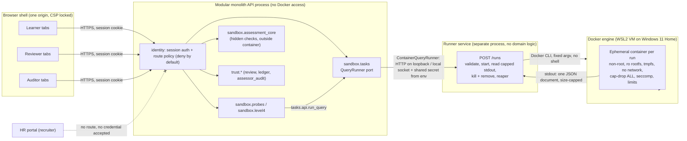

<!-- STATUS: DRAFT -->
# Sandbox Environment Design: per-run container and role-scoped browser shell

Owner: principal-architect | Gate: G3 | Version: 0.2 | Date: 2026-10-10 | Reviewer: security-engineer, then staff-code-reviewer, then compliance-auditor
Decision record: delivery/decisions/adr/ADR-0003-os-level-sandbox.md (Proposed, Founder decides).

## Revision
| Version | Change |
|---|---|
| 0.1 | First draft |
| 0.2 | Addresses High findings in sandbox-security-review.md. **SR-01:** new s3.0 runner request schema (no paths; UUIDs resolved against the runner's own allow-listed read-only store; closed `limits_profile` enum; size-capped submission sent only to container stdin; all else rejected; container arguments from a fixed template); C15, C16 and lifecycle step 3 updated; threat S-1 updated, S-11 added. **SR-02:** new s4.1 role and track assignment; enforcement rules updated; threat S-10 added. **Matrix:** learner tracks Python developer and Data analyst added with their workspace tabs (s4.2). Open questions Q6 revised and Q11, Q12 added. All values Proposed. |
Inputs: ADR-0001 (s3, FF-1), ADR-0002, ux-flows.md (s2-4, s10), threat-model.md (T-01a-e, T-02c, T-03b), architecture-overview.md (module map, AT list), implementation-plan.md (s1, s2, s10), contracts/README.md (invariants), dependency-policy.md.

> Every number, name and path below is **proposed** unless marked decided. Values are starting points to be measured in SLICE-003; none is a claim about measured behaviour. Nothing here authorises writing under `product/`.

## 1. Architecture

Key properties
- The API process never mounts `docker.sock` or the Docker Desktop named pipe and imports no Docker client (SBX-FF-5). Only the runner touches Docker.
- The runner accepts one request shape (s3.1), owns no data and holds no learner identity beyond an opaque `run_id`.
- `probes` and `level4` execute learner SQL only through `tasks.api.run_query` (T-01d).
- Hidden checks, expected outputs, probe answers and mutation answers are computed by server-authored SQL outside the container and are never sent to it (T-01b, T-03b).
- Windows caveat: any process under the Founder's Windows user can reach the Docker engine pipe; separation on the laptop is by code, tests and (if chosen) running the API in a container without the pipe. On Linux it is also separate OS users (ADR-0003, Windows constraints).

## 2. Container specification (proposed values)

| # | Control | Proposed setting | Purpose / threat |
|---|---|---|---|
| C1 | Image | Built from a repo Dockerfile; base `python:3.12-slim` (or distroless Python) **pinned by digest**; contains only the runner entrypoint (standard library); no package manager calls at run time; image digest pinned in config | Supply chain (S-2) |
| C2 | Image provenance | Build script records base digest and built image digest; runner refuses any other digest (SBX-FF-4); image scanned before demo (tool to be chosen and registered) | S-2 |
| C3 | User | Fixed non-root uid:gid, e.g. `10001:10001`; no shell login; no sudo in image | Privilege escalation |
| C4 | Root filesystem | `--read-only` | No persistence, no tampering with entrypoint |
| C5 | Writable space | `--tmpfs /tmp:rw,noexec,nosuid,nodev,size=16m` only | SQLite temp space; nothing executable |
| C6 | Network | `--network none` | No exfiltration, no callbacks, no access to host or other containers |
| C7 | Capabilities | `--cap-drop ALL`, no `--cap-add` | Kernel attack surface |
| C8 | Privilege | `--security-opt no-new-privileges`; never `--privileged`; no `--device` | setuid escalation |
| C9 | Seccomp | Docker default profile (never `unconfined`); custom stricter profile is a security-engineer decision | Syscall surface |
| C10 | Processes | `--pids-limit 32` | Fork bomb |
| C11 | Memory | `--memory 256m --memory-swap 256m` (no swap) | Memory exhaustion; OOM kill exit 137 |
| C12 | CPU | `--cpus 0.5` | Host starvation |
| C13 | ulimits | `--ulimit nofile=64:64`, `--ulimit fsize=16777216` (16 MB), `--ulimit core=0` | File handle and file size abuse, core dumps |
| C14 | Wall clock | Engine step budget about 2 s inside; runner hard deadline 5 s from start, then `docker kill`; never shown to the learner as a timer (G-8) | Runaway query (T-01c) |
| C15 | Seeded data | One dataset file containing **only the learner tables for one (task, dataset) pair**, resolved by the runner from its own allow-listed read-only store (s3.0) and mounted read-only at the fixed path `/data/dataset.sqlite` (alternative: runner streams it via stdin, Q4); copied into an in-memory SQLite by the entrypoint; `query_only=ON`. The mount source is computed by the runner from the manifest, never taken from a request | No cross-learner data, no hidden checks (T-01b); no arbitrary host or VM path (SR-01) |
| C16 | Input | Submission text (max 10,240 bytes UTF-8, proposed) is written by the runner to the container's stdin only; nothing from the request appears in argv, environment, file names, labels or mounts | Injection into the container command line (S-7, SR-01) |
| C17 | Output | Exactly one JSON document on stdout, schema-validated by the runner: `{status, columns, rows, row_count, truncated, error_code}`; max 1,000 rows and 1 MB; runner reads at most cap + 1 byte, then kills; stderr discarded except a capped diagnostic kept server-side; no engine error text shown to the learner verbatim | Result flooding; schema leakage (T-01b) |
| C18 | Environment | No environment variables except fixed, non-secret ones; no secrets ever (rule 8) | Secret exposure |
| C19 | Other isolation | `--ipc none`, own PID namespace (default), no host PID/IPC/UTS/network, fixed `--hostname sbx`, `--log-driver none`, `--init` | Information leakage; zombie reaping |
| C20 | Lifetime | `--rm` plus explicit `docker rm -f` in a `finally` path; label `smt.run_id=<uuid>` and `smt.started=<epoch>`; reaper removes labelled containers older than 30 s every 10 s and at runner start | No orphans (SBX-FF-3) |
| C21 | Isolation between runs | New container per run; no named volumes; no reuse; no container commit; dataset mounted read-only from the immutable store | No shared state (SBX-FF-3) |
| C22 | Concurrency | Runner pool of 2 concurrent runs, queue depth 8; beyond that returns "busy" | Runner DoS (S-3) |
| C23 | Runtime | `runc` (Docker default) for MVP; gVisor `runsc` candidate for Linux/cloud (Q3) | Defence in depth later |

## 3. Per-run lifecycle and failure modes

### 3.0 Runner request schema and dataset store (SR-01, proposed)

The runner accepts **no paths, no image names and no container options**. `POST /runs` takes exactly this JSON body (JSON Schema 2020-12, `additionalProperties: false`, every field required):

| Field | Type and constraint | Meaning |
|---|---|---|
| `run_id` | string, UUID v4, lowercase canonical form | Correlation ID generated by the API; used as the container label value after re-validation |
| `task_id` | string, UUID | Opaque ID of a published task version |
| `dataset_id` | string, UUID | Opaque ID of a published dataset (base, probe variant or Level 4 mutation variant) |
| `limits_profile` | closed enum: `sql_check`, `sql_submit`, `sql_probe`, `py_check`, `py_tests` | Selects a constant limits set compiled into the runner. `py_*` values are accepted only if Founder question Q1 approves the Python track; until then they are rejected |
| `submission` | string, UTF-8, 1 to 10,240 bytes (proposed; Python cap open in Q1) | Learner text. Written only to the container's stdin; never logged in full, never in argv, environment, labels, mounts or file names |

Rejection rules (all before any Docker call; uniform `400 invalid_request` with no echo of input):
- Any extra or missing field; any non-string type; any non-canonical UUID.
- Any `limits_profile` outside the enum, including case variants, empty strings and numbers.
- `submission` over the cap, empty, or not valid UTF-8.
- (`task_id`, `dataset_id`) pair not present in the store manifest, or dataset file hash not matching the manifest.
- Request without the shared runner secret (from environment, rule 8).

Fixed container template: the runner holds one constant argument list (s2 controls C1 to C21, the pinned image digest and the fixed mount target). It fills in only (a) the `run_id` label, (b) the mount source taken from the manifest entry for the validated `dataset_id`, and (c) the constants for the validated enum value. No request field is concatenated into any argument. A golden test asserts the generated list for every enum value (SBX-FF-10).

Dataset store:
- A runner-owned directory outside OneDrive, read-only to the runner at run time, containing dataset files named by `dataset_id` and a manifest `{dataset_id, task_id, task_version, kind (base | probe | mutation), sha256}`.
- Populated only by an offline publish step (`tasks` dataset publisher, run by a developer or at build), never by the API at run time.
- Per-learner data is achieved by assigning each learner a `dataset_id` from a pre-generated pool per task version, using the HMAC-derived seed rule already in the threat model (mitigation 7). Pool size proposed 200 per task version (Q12). Probe and Level 4 variants are pre-generated per pool entry.
- Alternative kept open (Q12): ship a pinned generator inside the image and pass only a seed index; rejected for now because it duplicates `tasks` domain logic inside the image.

### 3.1 Lifecycle
1. Learner action in an allowed tab (Task "Run check query" or "Submit", Probe answer, Level 4 adaptation) reaches the API; session and route policy checked (s4).
2. `tasks` validates input (length, single statement pre-check for SQL), resolves the published `task_id` and the learner's assigned `dataset_id` (base, probe or mutation variant). It builds no files for the runner.
3. `ContainerQueryRunner` sends the s3.0 body `{run_id, task_id, dataset_id, limits_profile, submission}` to the runner over loopback or a local socket, authenticated with a shared secret read from the environment.
4. Runner applies the s3.0 rejection rules, checks the concurrency slot and pinned image digest, resolves the dataset from its manifest, starts the container from the fixed template, and writes the submission to stdin.
5. Runner reads stdout up to the cap and waits until exit or the hard deadline.
6. Runner always kills (if still running) and removes the container, and returns a bounded result or an error code. (The dataset store is read-only, so there is no per-run directory to clean.)
7. `tasks` validates the result against the result schema and returns it to the caller (`assessment_core`, `probes`, `level4`); `integrity` fingerprints the result as before.
8. Learner sees outcome text only; runner diagnostics stay server-side with `run_id`.

### 3.2 Failure modes
| Failure | Detection | Runner behaviour | Learner sees (wording for ux-architect to confirm) | Recorded |
|---|---|---|---|---|
| Request fails s3.0 schema, enum, size, manifest or hash checks | Runner validation | Reject before any Docker call; no container created | Generic run error (oversize: "Your answer is too long to run. Shorten it and try again.") | Security log (count, rule violated; no input echo) |
| Docker not running / engine unreachable | CLI error at preflight or run | Refuse run; **no fallback in `container` mode** | "We could not run your query right now. Your work is saved. Try again." | Health endpoint degraded; error log |
| Image missing or digest mismatch | Preflight / inspect | Refuse run | Same as above | Security log (possible tamper) |
| Query exceeds engine budget | Engine stops, status `timeout` | Normal result path | "Your query took too long to run. Your work is saved. Try a smaller query." (no time figure, G-8) | Run record |
| Container exceeds hard deadline | Runner timer | `docker kill`, remove | Same as above | Run record |
| OOM kill (exit 137) | Exit code / inspect | Remove | "Your query used too much memory. Try a smaller query." | Run record |
| Output over cap | Byte count | Kill, remove, return `truncated` or `output_too_large` | "The result was too large to show. Try a query that returns fewer rows." | Run record |
| Malformed or multiple JSON documents | Schema validation | Treat as error | Generic run error | Security log (possible tamper) |
| Non-zero exit without result | Exit code | Remove | Generic run error | Run record |
| Pool full | Slot check | Return `busy` | "Many people are running queries. Your work is saved. Try again in a moment." | Metric |
| Runner crashes mid-run | API client timeout; reaper on restart | Reaper removes orphans | Generic run error | Error log |
| Disk or tmpfs full | Engine error | Remove | Generic run error | Run record |
| `in_process` mode enabled | Config | Runs via ADR-0001 engine in worker process | Persistent banner on every tab (ADR-0003 fallback) | `isolation_mode` on every run record |

## 4. Roles x tabs matrix (deny by default)

Enforcement rules (all proposed, server-side)
- **Role source:** the role is a claim on the authenticated server-side session issued by `identity` (s4.1). One role per session; a person holding two roles signs in separately; no client selector. The only switcher is the demo-only one in s4.1 (Q6).
- **Tab manifest:** `GET /shell/tabs` returns only the tabs allowed for the session role and, for learners, the session's track; the shell renders nothing else.
- **Route policy:** every API route declares `{tab_id, roles, track (learner track routes only)}`; middleware denies any route without a declaration, any role not listed, and any track-specific route whose track differs from the session's track (TAB-FF-1, TAB-FF-2, TAB-FF-8).
- **Run profile:** the `limits_profile` sent to the runner is derived server-side from (track, tab, action); the client never supplies it.
- **Object level:** learner routes use `me` resolved from the session; path parameters naming another learner are never trusted. Existing `GET /progress/{learner}` and `GET /profile/{learner}` become `/me/progress` and `/me/profile`, or must check equality with the session (decision for Dev 1 and Dev 2).
- **Uniform denial:** role and object denials both return the same not-available response (proposed HTTP 404, generic body) so no existence is revealed (in the spirit of invariant 15) (Q5). Denials are logged with role, tab_id and route, never with request bodies.
- **Direct URL:** a shell URL for a tab not in the manifest renders the "Not available" page and requests no data.
- **Recruiter:** no shell session type; HR credentials (different audience/cookie scope) are rejected by the shell API (TAB-FF-4).

### 4.1 Role and track assignment (SR-02, proposed)

| Rule | Detail | Test |
|---|---|---|
| R-1 Role source | Role is read only from the server-side session record created by `identity` at sign-in from its own account store (or the identity provider's verified claim). Sessions are opaque random IDs in an `HttpOnly` cookie; no role is stored in or trusted from the browser (cookie body, header, query string, request body, local storage). | TAB-FF-4, TAB-FF-7 |
| R-2 Sign-up | Self sign-up always creates role `learner`. Sign-up requests containing `role`, `roles`, `is_admin` or any field not in the sign-up schema are rejected. | TAB-FF-6 |
| R-3 Staff roles | `reviewer` and `auditor` are assigned out of band by an administrator (CLI or identity-provider console, not the shell). They are never offered at sign-up or in any UI selector. Admin assignment requires the admin's own authenticated session and is audited (R-6). | TAB-FF-6, TAB-FF-10 |
| R-4 Track is not a role | A learner's track (`python_developer` or `data_analyst`) is a preference field on the learner account. It selects the workspace tab manifest and the server-derived run profile only; it grants no privilege, never adds a staff tab or route, and is not accepted on staff accounts. Track changes go through `PUT /me/track`, validated server-side against the closed enum. | TAB-FF-8 |
| R-5 Demo switcher | A role switcher exists only when `DEMO_MODE=on` (config, off by default). It is labelled "Demo only: switches between sample accounts", lists only seeded demo identities, and performs a server-side sign-in as that identity (new session); it never sends a role value. With demo mode off, the route is not registered and the control is not rendered. Demo mode is also shown in the shell banner. | TAB-FF-9 |
| R-6 Audit | Every role grant or removal, track change and demo switch writes an append-only, hash-chained identity audit event `{actor, subject, change, old, new, at}` using the hash rule in `hash-canonicalisation.md`. These are not EvidenceEvents and are not shared with Trust consumers. | TAB-FF-10 |
| R-7 Change takes effect | Role changes invalidate the subject's existing sessions; track changes reload the manifest on the next request. | TAB-FF-7, TAB-FF-8 |

### 4.2 Matrix (all rows Proposed)

Columns: **PY** = learner, Python developer track; **DA** = learner, Data analyst track; **REV** = reviewer; **AUD** = auditor. "Own" means object-level checks against the session learner. The Python track depends on Founder question Q1; until Q1 is answered its rows are design only and `py_*` profiles are rejected by the runner.

| Tab ID | Tab | PY | DA | REV | AUD | Data loaded | Routes / APIs (indicative) | Starts a container run |
|---|---|---|---|---|---|---|---|---|
| `PY-BRIEF` | Brief | Allow (own) | Deny | Deny | Deny | Task instructions, visible acceptance criteria, level | `GET /me/workspace/brief` | No |
| `PY-EDITOR` | Editor | Allow (own) | Deny | Deny | Deny | Own draft code | `PUT /me/drafts/{task}`, `POST /me/runs` (server sets `py_check`), `POST /submissions` | Yes |
| `PY-TESTS` | Tests | Allow (own) | Deny | Deny | Deny | Visible tests only; hidden tests never sent to the browser or the container | `GET /me/workspace/tests`, `POST /me/runs/tests` (server sets `py_tests`) | Yes |
| `PY-OUTPUT` | Output | Allow (own) | Deny | Deny | Deny | Capped stdout/result of own latest runs | `GET /me/runs/{run_id}` | No |
| `DA-BRIEF` | Brief | Deny | Allow (own) | Deny | Deny | Task instructions, visible criteria, level | `GET /me/workspace/brief` | No |
| `DA-DATA` | Data | Deny | Allow (own) | Deny | Deny | Schema and preview of own assigned dataset only ("Your data is different from other learners' data") | `GET /me/datasets/{task}/preview` | No |
| `DA-SQL` | SQL editor | Deny | Allow (own) | Deny | Deny | Own draft query and note | `PUT /me/drafts/{task}`, `POST /me/runs` (server sets `sql_check`), `POST /submissions` | Yes |
| `DA-RESULTS` | Results | Deny | Allow (own) | Deny | Deny | Capped rows of own latest runs | `GET /me/runs/{run_id}` | No |
| `L-FEEDBACK` | Feedback (both tracks) | Allow (own) | Allow (own) | Deny | Deny | Own criterion results, method labels, rationale, visible-check diff | `GET /me/submissions/{id}/results` | No |
| `L-PROBE` | Probe (both tracks) | Allow (own) | Allow (own) | Deny | Deny | Altered data or changed input, question (no answer) | `GET /me/probes/{id}`, `POST /me/probes/{id}/answer` | Yes (own code on pre-published probe variant; `sql_probe` or `py_check`) |
| `L-PROFILE` | Profile (both tracks) | Allow (own) | Allow (own) | Deny | Deny | Own estimate band, evidence list, labels | `GET /me/profile` | No |
| `L-PATH` | My path (both tracks; ux-flows 4.1, placement for ux-architect) | Allow (own) | Allow (own) | Deny | Deny | Level status, attempt count | `GET /me/progress` | No |
| `L-LEVEL4` | Level 4 session (both tracks) | Allow (own) | Allow (own) | Deny | Deny | Prompts, own turns | `POST /me/level4/start`, `POST /me/level4/{id}/turn`, `POST /me/level4/{id}/adaptation` | Yes (adaptation, on pre-published mutation variant) |
| `L-SHARING` | Sharing (both tracks) | Allow (own) | Allow (own) | Deny | Deny | Own grants | `GET/POST /me/grants`, `DELETE /me/grants/{id}` | No |
| `L-APPEALS` | Appeals (both tracks) | Allow (own) | Allow (own) | Deny | Deny | Own appeals and decisions | `GET/POST /me/appeals` | No |
| `V-QUEUE` | Review queue | Deny | Deny | Allow | Deny | Case ID, alias, criterion, entry reason, confidence words, item age (G-9 alias only) | `GET /review/queue` | No |
| `V-CASE` | Review case and Decision recorded | Deny | Deny | Allow | Deny | Original work (query, note), AI rationale, rubric, probe result, review flags, appeal text | `GET /review/cases/{id}`, `POST /review/cases/{id}/decision` | **No** (reviewer sees stored results; never re-executes learner code) |
| `A-LEDGER` | Ledger check | Deny | Deny | Deny | Allow | Head sequence, head hash, verify result | `GET /ledger/head`, `GET /ledger/verify` | No |
| `A-REPORTS` | Assessor health reports and detail | Deny | Deny | Deny | Allow | Reports by rubric version; hash references only, never raw submissions (ux-flows 7.5) | `GET /assessor-reports`, `GET /assessor-reports/{id}` | No |
| `X-HELP` | Help and "Not available" page | Allow | Allow | Allow | Allow | Static same-origin content | static | No |

Explicitly denied to all shell roles: `POST /evaluate?test=true` (not registered in demo, T-01e), any runner endpoint, any HR portal route, any ledger write.

## 5. Browser-shell restrictions

| ID | Restriction (proposed) |
|---|---|
| B-1 | CSP on every response: `default-src 'self'; script-src 'self'; style-src 'self'; img-src 'self' data:; font-src 'self'; connect-src 'self'; frame-src 'none'; frame-ancestors 'none'; object-src 'none'; base-uri 'none'; form-action 'self'`. No inline scripts or styles; no `eval`. |
| B-2 | Headers: `X-Content-Type-Options: nosniff`, `Referrer-Policy: no-referrer`, `Cross-Origin-Opener-Policy: same-origin`, `Cross-Origin-Resource-Policy: same-origin`, `Permissions-Policy` denying camera, microphone, geolocation, payment, USB and similar; HTTPS outside localhost; session cookie `Secure` (outside localhost), `HttpOnly`, `SameSite=Strict`; CSRF token on state-changing requests. |
| B-3 | No iframes and no embedding of the shell elsewhere (`frame-ancestors 'none'`). |
| B-4 | No external navigation: the shell contains no external links; any URL in learner or AI text is rendered as plain text, not a link (T-02c). |
| B-5 | `window.open` and `target=_blank` only for same-origin `X-HELP` pages on an allow-list; enforced by a lint rule and a review check. |
| B-6 | No cross-tab data: each tab loads its own data from its own routes; no client-side store shared across tabs; no learner data in `localStorage`, `IndexedDB` or `BroadcastChannel`; drafts autosave server-side (A11Y-4). |
| B-7 | All learner, AI and reviewer text rendered as text (no HTML injection APIs, no HTML markdown) (T-02c). |
| B-8 | Copy and paste inside the query editor and text fields is allowed (accessibility and normal use); the shell does not read the clipboard. |
| B-9 | Accessibility rules in ux-flows s10 apply to the shell itself: tab list keyboard-operable (A11Y-1, A11Y-3), "Not available" page has one `h1` and a route home (A11Y-13), reduced-isolation banner announced once via `role="status"` (A11Y-8). |

ux-flows global rules that the shell and runner must honour (copied by reference, ux-flows s3): G-1 (no aggregate, rank or match %), G-2 and G-10 (estimate with band and as-of date), G-3 (experimental label), G-4 (AI-assisted label with appeal), G-5 (probe wording "Output verified, understanding unconfirmed"), G-6 (flags only on `V-CASE`/`V-QUEUE`, never elsewhere), G-7 (method labels), **G-8 (no timers: run limits are never shown as countdowns or durations)**, G-9 (alias only outside the learner's own tabs).

## 6. Mapping to modules and slices

| Module / component | Change |
|---|---|
| `sandbox.tasks` | `QueryRunner` port unchanged. New infrastructure adapters: `ContainerQueryRunner` (default) and `InProcessQueryRunner` (ADR-0001 engine in a worker process, labelled). Selected by `SANDBOX_MODE`. Builds the per-run seeded dataset. Owns the run-result schema. |
| `sandbox.assessment_core` | No change to domain. Consumes the run result; hidden checks stay outside the container. Must treat `timeout`, `oom`, `output_too_large`, `busy` as non-results, not as failed criteria. |
| `sandbox.probes`, `sandbox.level4` | Call `tasks.api.run_query` only (unchanged rule, now with container latency). |
| `sandbox.integrity` | No change; fingerprints the bounded result. |
| `trust.identity` | Adds role claim on server-side sessions (learner, reviewer, auditor), learner track preference, role/track-to-tab policy table, `authorize(session, tab_id, route)`, tab manifest, admin role assignment, demo switcher (demo mode only), hash-chained identity audit log (s4.1); rejects HR audience in the shell. |
| `sandbox.tasks` (dataset publisher) | Offline step that pre-generates pool datasets, probe and mutation variants and the store manifest (s3.0); maps learners to `dataset_id` by the HMAC seed rule. |
| Runner service (new helper process, not a module) | One endpoint, lifecycle, caps, reaper, digest check. Location under `product/` to be set in the delivery plan (no files written now). |
| Container image (new artefact) | Dockerfile, pinned base digest, entrypoint (standard library), build script recording digests. |
| `learner-ui` becomes the browser shell | Renders the manifest; tabs for learner, reviewer and auditor screens; CSP-compatible build; banner for reduced isolation. |
| Architecture tests | Add SBX-FF-1..6 and TAB-FF-1..5 (ADR-0003) to `product/architecture-tests/` specification. |

| Slice | Change (proposed, for the delivery plan after Founder decision) |
|---|---|
| SLICE-001 walking skeleton | Adds: session role claim; route policy middleware (deny by default); `GET /shell/tabs`; shell with manifest-driven tabs and "Not available" page; CSP and headers; runner service skeleton with health check and Docker preflight; `SANDBOX_MODE` switch and banner. Also role and track assignment (s4.1), track-scoped manifests, identity audit events. Tests TAB-FF-1..10, SBX-FF-5, SBX-FF-6 (health part). Size S to M (may approach L with s4.1; to be re-estimated). |
| SLICE-003 seed and runner | Adds: image build and pinning; `ContainerQueryRunner`; full lifecycle and failure modes; reaper; caps. Also s3.0 request schema, dataset store and publisher. Tests FF-1 via container, SBX-FF-1..4, SBX-FF-6..10. Size M to L. Cut line at H10: switch to labelled `in_process`; then fixed query set. |
| SLICE-007 probes, Level 4 slices, review and audit UI slices | Route policy declarations and matrix rows added per new route. |

## 7. Threats for security-engineer review

Proposed IDs; to be merged into threat-model.md by security-engineer.

| ID | Threat | Proposed mitigation | Test |
|---|---|---|---|
| S-1 | Docker socket/pipe exposure: API compromise gives root-equivalent engine control | API never mounts or opens the socket or pipe; only the runner holds access; runner endpoint accepts only the closed s3.0 schema (no paths, no options), builds arguments from a fixed template, shared secret from env, loopback/local socket only; on Linux separate OS user; on Windows stated limitation | SBX-FF-5, SBX-FF-7..10; `should_reject_run_request_without_secret` |
| S-2 | Image supply chain: tampered or drifting base image | Base pinned by digest; image built locally; runner refuses other digests; scan before demo; no runtime installs | SBX-FF-4 |
| S-3 | Runner DoS: many runs, slow runs, output floods, orphaned containers | Pool and queue caps; per-learner rate limit (proposed 10 runs per minute); hard deadline; output cap with early kill; reaper; memory, CPU, pids limits | `should_return_busy_when_pool_full`; SBX-FF-3 |
| S-4 | Container escape via kernel or runtime bug | Non-root, cap-drop ALL, no-new-privileges, seccomp default, read-only rootfs, no network; WSL2 VM as second boundary on Windows; gVisor later (Q3) | SBX-FF-1, SBX-FF-2 |
| S-5 | Tab or role bypass: forged role, direct URL, direct API call, IDOR on learner IDs | Role from session only; route policy deny-by-default; `me` resolution; uniform denial | TAB-FF-1..4 |
| S-6 | Data leakage across learners: shared dataset, reused container, leftover tmpfs, cached results | Per-run dataset with only the learner's tables; single-use containers; per-run directory deleted; result cache (if any) keyed by `run_id`, never by SQL text alone | SBX-FF-3; `should_not_return_other_learner_rows_when_seed_differs` |
| S-7 | Command-line or label injection through learner text into the Docker invocation | Learner data only via stdin JSON; argv built from constants and a server-generated UUID | `should_not_pass_learner_text_in_argv` |
| S-8 | Hidden data reaching the container or learner (expected outputs, other tables, engine error text revealing schema) | Hidden checks outside the container; dataset contains learner tables only; generic error messages | T-01b, T-03b tests via container |
| S-9 | Silent downgrade to weaker isolation | Fail closed in `container` mode; `in_process` only by explicit config, labelled everywhere, recorded per run | SBX-FF-6 |
| S-10 | Privilege gained through role assignment: self-assigned staff role at sign-up, forged or tampered role claim, track change used as privilege, demo switcher left on (SR-02) | s4.1 R-1 to R-7: session-only role, learner-only sign-up, out-of-band staff assignment, track is non-privileged, demo switcher off by default and not registered, audited changes | TAB-FF-6..10 |
| S-11 | Compromised API steers the runner to mount arbitrary host or VM paths or alter container options (SR-01) | Runner accepts no paths or options; UUIDs resolved against its own manifest with hash check; closed enum; fixed template | SBX-FF-7..10 |

## 8. Open questions for the Founder

| # | Question | Architect's proposal |
|---|---|---|
| Q1 | Language ladder: SQL only (D1 current) or also Python inside the container? | SQL only for the 24 h build; the container keeps Python possible later as a new image with stricter limits and its own escape suite |
| Q2 | Demo location: local laptop (Docker Desktop/WSL2) or hosted (Linux VM/cloud)? | Local for the hackathon; hosted only with a separate ADR (runner on a dedicated host, network isolation, authentication) |
| Q3 | gVisor (`runsc`) or rootless Docker now, or in the Linux/cloud phase? | Later phase; on Windows Home they need a separate Docker engine inside a WSL2 distro |
| Q4 | Dataset delivery: read-only bind mount from a runner-owned directory outside OneDrive, or stdin only (no host mount at all)? | Prefer stdin if datasets stay small (under about 1 MB); otherwise read-only mount |
| Q5 | Denial response: uniform 404 for role and object denials, or 403 for role denials? | Uniform 404 with generic body |
| Q6 | One role per session (separate sign-in per role), with a demo-only switcher between seeded accounts (s4.1 R-5), acceptable? | Yes |
| Q7 | Must the ledger EvidenceEvent record `isolation_mode`? Needs a contract change agreed by all three developers | Record on local run records now; contract change only if `in_process` is ever used in a demo |
| Q8 | Topology on the laptop: API on host or in a container without the Docker pipe? | API in a container without the pipe if setup time allows; otherwise host, with SBX-FF-5 as the control and the limitation stated |
| Q9 | Docker Desktop licence eligibility for this use | Founder to confirm before adding to the dependency register |
| Q11 | May one learner hold both tracks (Python developer and Data analyst) at once? If yes: one active track per session with a switch (simplest), or both manifests merged? Are evidence and estimates kept per track? | One active track per session, switched via `PUT /me/track` and audited; evidence is per competency, so no merging is needed; confirm before SLICE-001 |
| Q12 | Dataset pool size per task version (proposed 200), or pinned generator in the image with a seed index instead of a pre-published store (s3.0)? | Pre-published pool; size confirmed by measuring store size and copy-detection rate in SLICE-003 |
| Q10 | Is pre-event setup (WSL2, Docker Desktop, base image pull) allowed outside the 24 h clock under the hackathon profile? | Yes if the profile permits; otherwise budget about 1 hour per machine inside the clock |

## 9. Assumptions
- Docker Desktop with WSL2 backend enforces cgroup v2 limits (pids, memory, CPU) and the default seccomp profile in the WSL2 kernel. To be verified by SBX-FF-1/2 on the Founder's machine.
- Datasets per task are small (tens to hundreds of kilobytes).
- Cold-start latency is acceptable within the existing "Evaluating" state (ux-flows 4.6); to be measured in SLICE-003.
